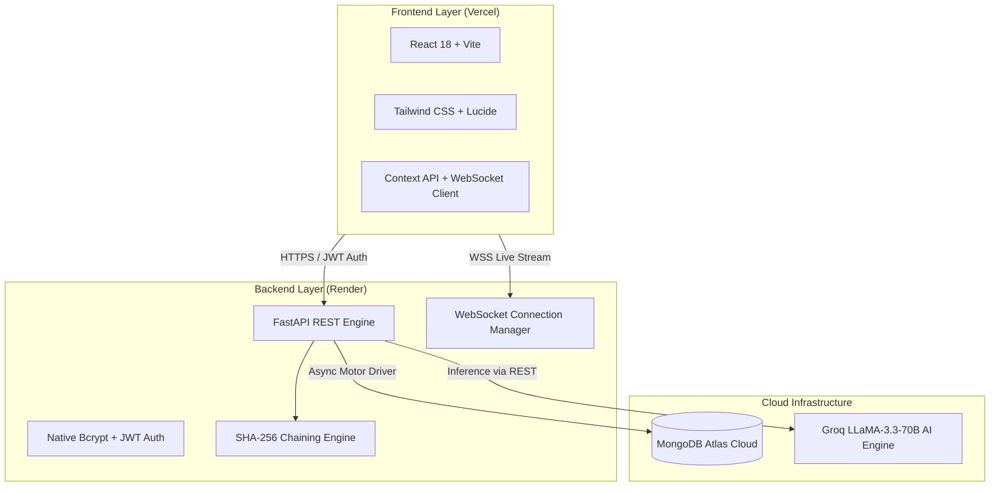

# 🌐 Audit Trail 2.0 — Enterprise Logistics Ledger & AI Dispute Platform

[](https://audit-trail-2-0.vercel.app/)
[](https://audit-trail-2-0.onrender.com)
[](https://audit-trail-2-0.onrender.com/docs)
[](https://audit-trail-2-0.vercel.app/)
[](https://mongodb.com)
[](https://groq.com)

> **HackDay 2026 Submission**: An enterprise-grade, tamper-evident logistics provenance ledger and automated multi-party dispute arbitration system powered by SHA-256 cryptographic chaining, real-time IoT cold-chain telemetry, and LLaMA-3.3-70B AI.

---

## 🔗 Quick Live Links & Demo

| Service | Live Deployment URL | Description |
|---|---|---|
| 🖥️ **Web Application** | [**audit-trail-2-0.vercel.app**](https://audit-trail-2-0.vercel.app/) | Interactive Client Dashboard & Tracking UI |
| ⚡ **Backend API Engine** | [**audit-trail-2-0.onrender.com**](https://audit-trail-2-0.onrender.com) | FastAPI REST & WebSocket Server |
| 📖 **Interactive Swagger Docs** | [**audit-trail-2-0.onrender.com/docs**](https://audit-trail-2-0.onrender.com/docs) | Full Interactive OpenAPI Explorer |
| 📊 **Alternative API Docs** | [**audit-trail-2-0.onrender.com/redoc**](https://audit-trail-2-0.onrender.com/redoc) | Redoc Standard Documentation |

---

## 🎯 Evaluator Demo Accounts

Click any 1-Click Profile in the login modal, or sign in directly with the following pre-seeded credentials:

| Role | Email Address | Password | Permissions Scope |
|---|---|---|---|
| 👑 **Platform Admin** | `admin@audittrail.io` | `password123` | Full unrestricted master view & Role Switcher |
| 📊 **Logistics Manager** | `robert.h@globalfreight.org` | `password123` | Tripartite disputes, carrier SLAs, AI arbitration |
| 🏭 **Cargo Supplier** | `arthur.p@novartis.com` | `password123` | Outbound shipments, dispatch proofs & claims |
| 🚚 **Logistics Transporter** | `marcus.v@aerocold.com` | `password123` | Telemetry logs, vehicle tracking, custody handovers |
| 🏥 **Consignee Receiver** | `tariq.m@dubaihealth.ae` | `password123` | Inbound delivery checks, shortages, damage disputes |
| ⚖️ **Compliance Auditor** | `sarah.chen@globalaudit.org` | `password123` | SHA-256 chain verification, replay, PDF reports |

---

## ✨ Key System Features

- 🔐 **Cryptographic SHA-256 Ledger**: Every IoT sensor reading and custody handover is hashed and chained to previous blocks, making the supply chain data immutable and tamper-evident.
- 🤖 **AI-Driven Dispute Arbitration**: Powered by Groq's `llama-3.3-70b-versatile`, analyzing multi-party claims, temperature logs, and photographic evidence to produce objective diagnostic summaries.
- 🛡️ **Role-Based Access Control (RBAC)**: Strict data fencing across 6 logistics participant personas ensuring organizational data isolation.
- ⚡ **Real-Time IoT Telemetry & WebSockets**: Instant broadcast of excursion alerts and temperature breaches via live WebSocket connections.
- 📜 **Downloadable Cryptographic PDF Certificates**: Automated compliance certificates showing complete Merkle chain verification for regulatory audits.
- ⚙️ **User Profile Management**: Live profile editing with password updates and organizational entity sync to MongoDB.

---

## 🏗️ Architecture & Technology Stack



### Technology Highlights:
- **Frontend**: React 18, Vite, Tailwind CSS, Lucide Icons, Headless UI, React Hot Toast
- **Backend**: FastAPI (Python 3.11), Motor (Async MongoDB), PyJWT, Native Bcrypt, FPDF2
- **Database**: MongoDB Atlas Cloud
- **AI & ML**: Groq Cloud API (`llama-3.3-70b-versatile`)
- **Hosting**: Vercel (Frontend), Render (Backend)

---

## 🚀 Local Development Setup

### 1. Clone the repository
```bash
git clone https://github.com/maurya0607/Audit-Trail-2.0.git
cd Audit-Trail-2.0
```

### 2. Backend Setup
```bash
cd backend
python -m venv .venv
# Windows:
.venv\Scripts\activate
# Linux/macOS:
source .venv/bin/activate

pip install -r requirements.txt
uvicorn app.main:app --host 127.0.0.1 --port 8000 --reload
```
API will run at `http://127.0.0.1:8000`.

### 3. Frontend Setup
```bash
cd ../frontend
npm install
npm run dev
```
Application will be available at `http://localhost:5173`.

---

## 📁 Repository Structure

```text
Audit-Trail-2.0/
├── backend/
│   ├── app/
│   │   ├── middleware/      # JWT decoder & Native Bcrypt RBAC
│   │   ├── routes/          # Auth, Disputes, Shipments, Ledger, Risks
│   │   ├── schemas/         # Pydantic schemas & payload validators
│   │   ├── services/        # Groq AI Service, Hash Chain, Replay Service
│   │   ├── database.py      # Async MongoDB Motor connection
│   │   └── main.py          # FastAPI application & WebSocket manager
│   ├── requirements.txt     # Python dependencies
│   └── .env.example         # Environment template
├── frontend/
│   ├── src/
│   │   ├── components/      # UI, Navbar, Dashboard, Modals, Forms
│   │   ├── context/         # AuthContext (RBAC) & ShipmentContext
│   │   ├── pages/           # Dashboard, Shipments, Disputes, ProfileEdit, etc.
│   │   ├── routes/          # Tab router & Role authorization guards
│   │   └── services/        # Centralized API client & Auth services
│   ├── package.json
│   └── vite.config.js
└── README.md
```

---

## 👥 Authors & Team Members

- **Lead Developer & Architecture**: [Vishal Maurya](https://github.com/maurya0607)
- **Team Member & Collaborator**: Ananya Gupta
- **Built For**: HackDay 2026 Enterprise Innovation Track
- **License**: MIT License
